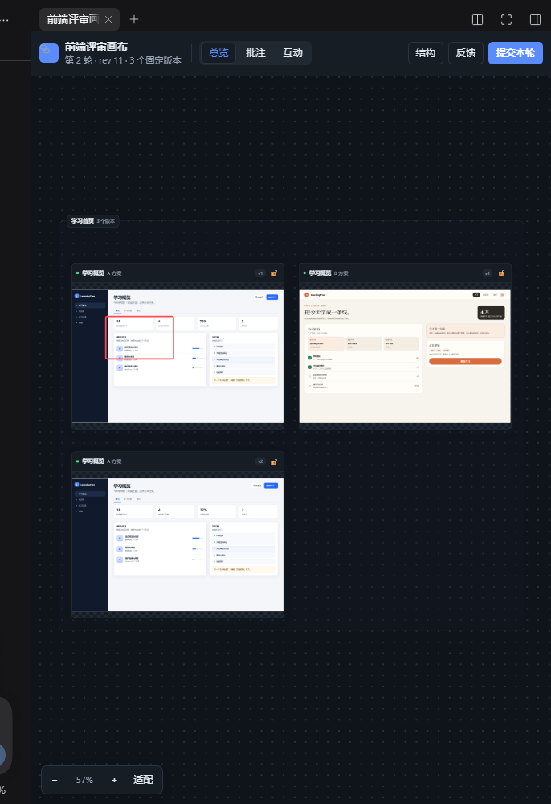
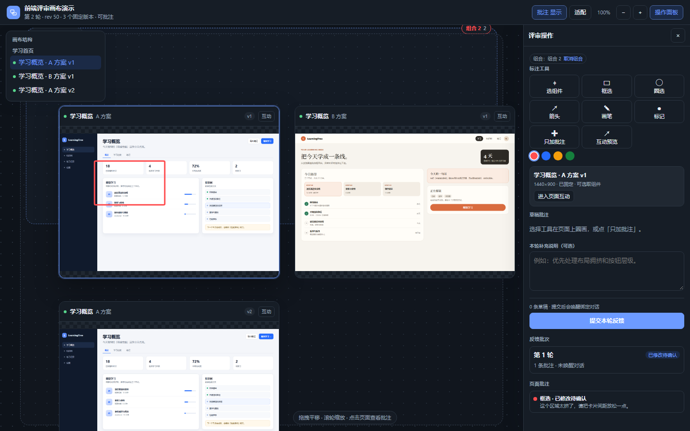
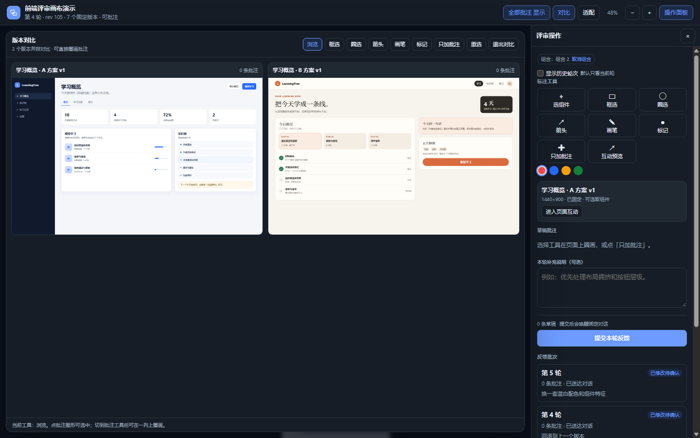
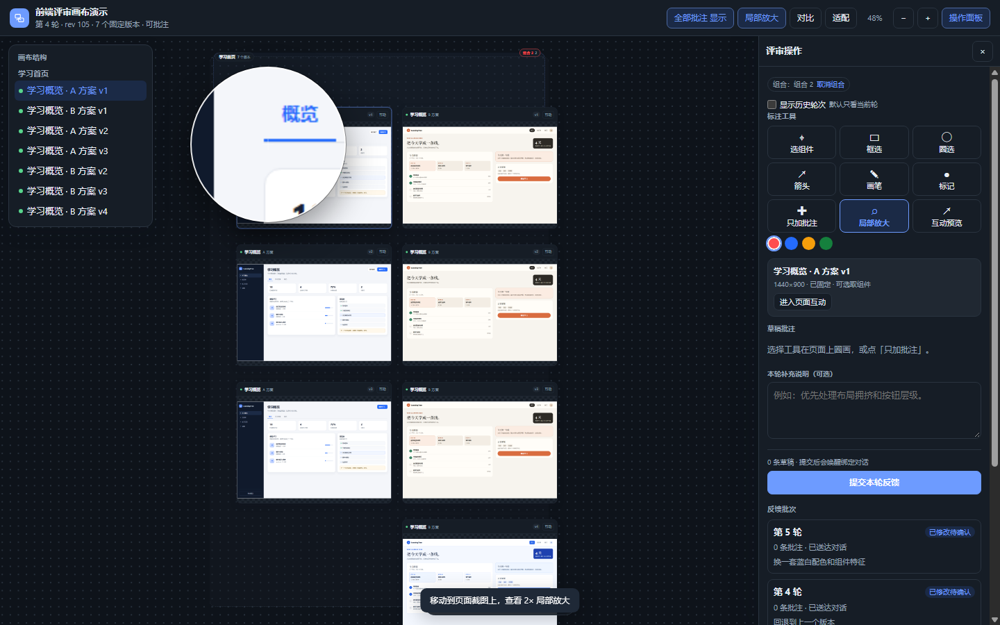
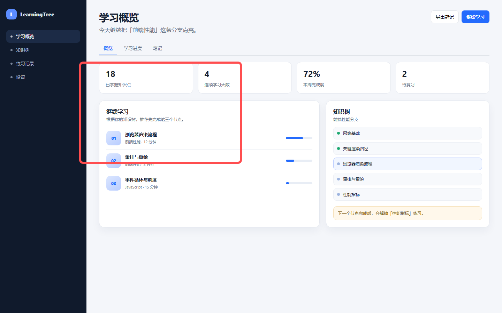

# 前端评审画布 · Frontend Review Canvas

一个 DeepSeek Harness 插件 + Skill：把当前项目的前端页面固定到与对话绑定的无限画布，在截图上圈画、批注，提交后让原对话继续修改，并把下一版固定到下方。旧版本、旧截图和旧批注不会被覆盖。



独立交互画布（不依赖 Harness 登录 cookie，可单独打开或投屏）：



右上角「对比」可勾选 2–4 个固定版本并排查看，直接在对比列上圈画：



「局部放大」开启跟随鼠标的 2× 放大镜，可检查局部文案和间距：



## 它解决什么

普通聊天里的「这里再松一点」很难定位。这个插件把反馈变成有对象、有现场证据的材料：

- AI 调用 `review_open`，创建/恢复当前项目 + 当前对话的画布；
- AI 用 `review_import` 导入运行中的页面、静态 HTML 或设计图，截成固定 PNG；
- 用户在画布上圈选、箭头、画笔、放置标记并写文字；
- 提交后，反馈批次通过 Harness 的 `agent.followup()` 唤醒绑定对话；
- AI 读取 `review_get_feedback` / `review_get_evidence`，修改代码；
- `review_publish` 以相同的 `pageKey` / `variantKey` 发布新固定版本，旧版保留并显示在下方；
- 用户确认解决后，批次进入 `已确认`。

## 安装

这是一个 DeepSeek Harness bundle 插件。先克隆仓库：

```powershell
git clone https://github.com/1120370331/dsh-frontend-review.git
cd dsh-frontend-review
```

然后在 Harness 里通过 `plugin_manager` 安装本地 bundle，`target` 指向仓库根目录：

```text
plugin_manager action=install_bundle target="C:\path\to\dsh-frontend-review"
```

安装后启用插件并**刷新/重新加载一次 Harness 界面**，让客户端模块进入 boot manifest；之后打开任意会话，输入框下方会出现「评审」按钮，右侧栏会出现「前端评审」标签页。

> 这个仓库目前没有发布到 npm；安装的是本地克隆目录。Harness 版本需要支持 `plugin_manager` 的 bundle patch 与 client module 加载。

## 使用

### 让 AI 导入页面

在对话里说：

> 把首页和设置页拿进来，首页再做 A/B 两个方案。

AI 会调用：

```json
{
  "pages": [
    {
      "pageKey": "home",
      "title": "首页",
      "variantKey": "a",
      "variantName": "A 方案",
      "sectionTitle": "首页",
      "source": { "kind": "url", "url": "http://127.0.0.1:5173/" }
    }
  ]
}
```

也可以直接点击输入框下方的「评审」，在空画布上让 AI 继续导入。

`review_open` 还会返回一个 `canvasUrl`，指向 `/frontend-review/canvas` 的独立交互画布。这个页面不依赖 Harness 的登录 cookie，适合在浏览器里直接打开、分享或投屏；它支持进入页面互动、选择组件、框选/圈选/箭头/画笔/标记、只加文字批注、右侧草稿编辑和提交反馈。Harness 右侧栏是同一套数据的另一个入口，二者可以交替使用。

### 圈画和提交

1. 点「批注」，选择矩形、圈选、箭头、画笔或标记；
2. 在页面截图上拖拽/点击；
3. 在右侧补充文字；文字会自动保存；
4. 点「提交本轮」。

提交会创建反馈批次，并尝试唤醒绑定对话。若原对话未运行，反馈仍会保存，画布会显示失败原因；批次历史里会出现「重试唤醒对话」，不会重复创建批次。

AI 读取到的证据是原截图叠加批注后的图片，同时带有页面、方案、版本和归一化坐标：



### 发布下一版

AI 修改代码后调用 `review_publish`，用相同的 `pageKey` 和 `variantKey`：

```json
{
  "respondsTo": ["fb_..."],
  "note": "放松卡片间距，主按钮加箭头",
  "pages": [
    {
      "pageKey": "home",
      "variantKey": "a",
      "source": { "kind": "url", "url": "http://127.0.0.1:5173/" }
    }
  ]
}
```

新版本出现在该方案下方；未修改的页面不会被迫生成新版。截图失败会返回 `status: "failed"`，反馈不会被标记为已修改。

## AI 工具

| 工具 | 作用 |
|---|---|
| `review_open` | 创建/恢复当前对话绑定的画布，返回 `reviewId` 并打开右侧面板 |
| `review_import` | 批量导入页面/方案/参考图，生成第一版固定截图 |
| `review_publish` | 发布固定新版本，关联反馈批次，旧版保留 |
| `review_arrange` | 分区、归组、移动、锁定、自动对齐 |
| `review_read` | 读取结构、版本、位置、锁定和反馈计数 |
| `review_get_feedback` | 读取批次、原文、目标和归一化坐标 |
| `review_get_evidence` | 获取叠加批注的截图证据 |
| `review_update_feedback` | 回复、更新状态、关联新版本；`confirmed` 只能由用户操作 |

Skill 位于 `skills/frontend-review/`，详细参数和流程见其中的 `references/`。

## 数据与固定版本

默认数据目录：

```text
$DSH_HOME/storages/frontend-review/
  reviews/<reviewId>.json
  assets/<reviewId>/<versionId>.png
  assets/<reviewId>/<versionId>.html
```

每个版本保存截图、可用 HTML、视口尺寸、来源和创建时间。旧版本文件从不覆盖；发布新版本会写新的文件。数据目录可用环境变量 `DSH_REVIEW_DATA_DIR` 覆盖。

## 页面来源

| kind | 行为 |
|---|---|
| `url` | 用本机 Chrome/Edge 无头模式在指定视口截取固定 PNG；`capture:false` 只创建实时预览 |
| `html` | 保存 HTML，按可选 `baseUrl` 解析相对资源，再截图 |
| `image` | 复制 PNG/JPEG/GIF/WebP 作为固定画面 |
| `existing` | 复制同一方案最近的固定截图，用于只改说明的发布 |

没有安装 Chrome/Edge 时，截图会失败并给出 `BROWSER_NOT_FOUND`；设置 `DSH_REVIEW_CHROME` 指向 Chromium 可执行文件即可。

## 交互与边界

- **总览**：在非页面区域（空白、分区底、组合框）按住拖动即可平移视角；也支持空格/中键/Alt+拖动和右上角抓手；滚轮缩放；拖动卡片标题栏移动卡片；按住 `Shift`/`Ctrl` 多选、组合/取消组合、右键菜单锁定/重命名/删除草稿。
- **大屏批注**：双击卡片内容，或点卡片「大屏」/右侧「进入大屏批注」，用固定截图铺满大屏后直接圈画；单次点击只选中卡片。
- **批注**：矩形、圈选、箭头、画笔、标记、只加批注、组件选取；点在图形上可选中并弹出文字浮层。
- **批注可见性**：默认只看当前反馈轮次 + 本轮草稿；右侧勾选「显示历史轮次」后显示旧轮次。顶部「全部批注」控制整体显隐。
- **批注管理**：右侧列表支持复选、快速删除草稿、批量删除；已提交/已修改批注只读保留。
- **撤销**：`Ctrl+Z` 或右上角 ↶ 撤销上一条新建/删除的批注；在批注文本框中按 `Ctrl+Z` 仍是文本撤销。
- **版本对比**：右上角「对比」勾选 2–4 个固定版本，进入并排对比；在任意一列上圈画，批注会写入该列对应的版本。
- **局部放大**：右上角或右侧「局部放大」开启跟随鼠标的 2× 放大镜，画布和对比列都可用；不改变全局缩放。
- **互动**：在卡片内加载实时 URL 或保存的 HTML；桌面页保持 1440px 视口渲染后再整体缩放，不会因为画布缩小触发手机布局。在预览里可以浏览页面，也可以直接切框选/圈选/画笔批注；HTML 快照还能选组件。按 `Esc` 返回总览。
- 画布默认按「业务模块分区 → 页面/方案横排 → 新版本下移」排布；锁定的卡片在自动整理时保留。
- 一个项目 + 一个对话默认一个画布；重复调用 `review_open` 不会新建。
- 页面很多时默认显示固定截图；只有进入互动模式的卡片才加载 iframe。
- 独立画布链接使用短期 token，可由 `review_open` 返回；token 随 Harness 进程轮换，不要把它当作长期公开链接。

## 已知限制

- 需要页面可被本机无头浏览器访问；登录态、复杂 SPA 的服务端渲染或跨域资源可能需要改用 HTML/图片源。
- 截图是固定视觉副本；真实业务写入在互动页面中仍会调用该项目自己的接口。
- 当前版本没有录屏、多人协作、差异高亮和 MCP 入口。
- `confirmed` 是用户专属状态，AI 工具不能代替用户确认。
- 画布客户端依赖 Harness 右侧栏与 slots；首次安装后需要一次页面刷新。若右侧栏不可用，工具仍能创建和读取数据，但面板无法自动打开。

## 开发

```powershell
node --test tests/*.test.js
```

主要文件：

- `index.js`：Host 插件入口、工具注册、Skill provider、HTTP 路由挂载；
- `lib/service.js`：评审线程、版本、反馈、布局、分组、证据；
- `lib/store.js`：JSON 持久化与乐观并发；
- `lib/capture.js`：Chromium DevTools Protocol 截图；
- `lib/http.js`：画布 API；
- `lib/canvas-page.js` / `standalone/`：独立交互画布；
- `client.js`：右侧栏画布 UI；
- `skills/frontend-review/`：AI 工作流 Skill；
- `demo/`：A/B 两套演示页面及其迭代版本。

测试覆盖评审导入、批注、提交、发布、旧版本保留、失败重试、自动排布和 `review_open`。截图相关代码需要本机 Chrome/Edge，测试使用静态 HTML 与临时数据目录。

## 安全与数据

- 画布数据默认只写入本机 `$DSH_HOME/storages/frontend-review/`，不发送遥测。
- 独立画布通过 token 访问，token 由 Harness 进程生成；不要把带 token 的链接贴到公开渠道。
- 导入 URL 时，截图由本机无头浏览器完成；页面自身的接口调用发生在你自己的运行环境里。
- 发现安全问题请不要公开提交 issue，先通过仓库维护者的 GitHub 联系方式私信。

## 贡献

欢迎提交 issue 和 pull request。开始前：

```powershell
npm test
```

请保持版本不可覆盖的约束：新改动发布为新版本，不改写旧截图、旧 HTML 或旧批注。提交 PR 时附上修改前后截图或测试输出。

## License

MIT
